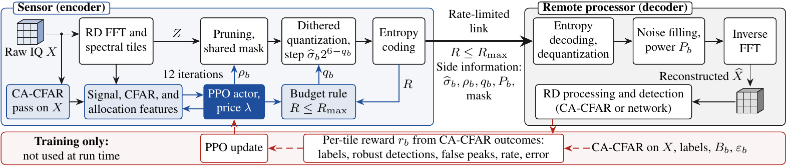
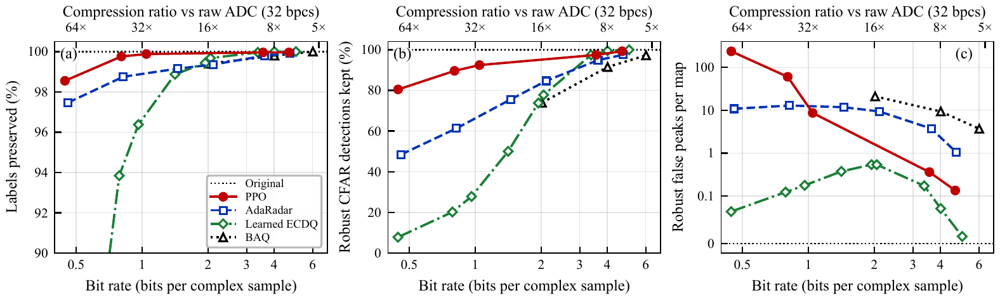
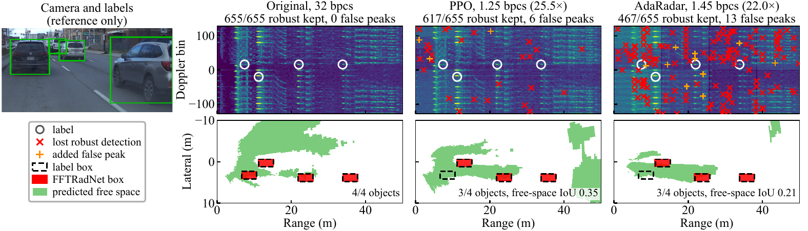

# Detection-Aware Compression of Raw FMCW Radar Data Cubes for Multi-Agent Perception

Danial Dehghani, Seyed Khashayar Modarres, Friedemann Laue, Maximilian Lübke, Norman Franchi. Institute for Smart Electronics and Systems (LITES), FAU Erlangen-Nürnberg. *Under review.*

This repository holds the complete code, the trained policy weights and the results of the paper, on RADIal and on the UW Camera-Radar dataset (UWCR). A radar sensor shares its raw in-phase and quadrature (IQ) cubes over a rate-limited link, and a remote processor reconstructs them and runs its own detection. The codec is built to preserve the evidence a constant-false-alarm-rate (CFAR) detector needs. A proximal policy optimization (PPO) policy at the transmitter chooses, for every spectral tile, how many coefficients to keep and how finely to quantize them. At run time the policy needs neither feedback from the receiver nor a trained detection network.

| | RADIal, 2,048 test cubes | UWCR, 3,592 held-out frames |
|---|---|---|
| **Proposed, operating point** | **1.05 bpcs (30.6×)**: 99.9% labels, 92.4% robust CFAR detections, 8.64 robust false peaks per map | **1.23 bpcs (26.0×)**: 99.7% labels, 98.7% robust CFAR detections, 0.23 robust false peaks per map |
| Closest reference | AdaRadar at 1.45 bpcs: 99.2%, 75.6%, 11.75 | Learned ECDQ at 1.22 bpcs: 98.8%, 79.7%, 0.07 |
| Frozen FFTRadNet F1, 1,386 official test cubes | 88.2% (uncompressed: 88.3%; AdaRadar at 1.45 bpcs: 85.2%) | not evaluated (CFAR only) |

**Contents.**
[1 Method](#1-method) ·
[2 Folder layout](#2-folder-layout) ·
[3 Where each part of the paper is in the code](#3-where-each-part-of-the-paper-is-in-the-code) ·
[4 Trained weights](#4-trained-weights) ·
[5 Running the code](#5-running-the-code) ·
[6 Results](#6-results) ·
[7 Result files](#7-result-files) ·
[8 Reproducibility notes](#8-reproducibility-notes)

---

## 1. Method

<p align="center"></p>

*Fig. 1 of the paper. A transmitter-side policy assigns tile-wise pruning and quantization parameters from locally computed features. The decoder reconstructs the IQ cube with noise filling and an inverse RD transform. Detection outcomes give a training reward only. No decoder feedback is needed at inference.*

The cube $X\in\mathbb{C}^{N_{\mathrm{rx}}\times M\times N}$ (RADIal: 16 × 256 × 512) is compressed to a bit budget $R\le R_{\max}$. Detection is judged by applying the same RD processing, CA-CFAR and non-maximum suppression to $X$ and to the reconstruction $\widehat X$.

### 1.1 Codec

1. **RD transform and tiles.** A unitary 2-D FFT over chirps and fast time gives the RD spectrum $Z$ for each receive channel. On RADIal, the grid is split into 64 tiles of 32 Doppler × 64 range-frequency positions.
2. **Shared-mask spectral pruning.** For tile $b$, the energy of each position is summed over the receive channels, $e_b(u,v)=\sum_r |Z_b(r,u,v)|^2$. The $k_b=\lceil\rho_b n_b\rceil$ strongest positions are kept in *all* channels, which preserves the cross-channel phase needed for angle estimation. The mask costs at most $1/N_{\mathrm{rx}}$ bpcs.
3. **Noise-referenced dithered quantization.** The step follows a robust estimate of the tile's noise level, not its largest coefficient:

   $$\widehat\sigma_b^2=\frac{\operatorname{median}|Z_b|^2}{2\ln 2},\qquad \Delta_b=\widehat\sigma_b\,2^{6-q_b},\qquad \widehat z=\Delta_b\,\mathrm{round}\!\left(\tfrac{z}{\Delta_b}+d\right)-\Delta_b d,\quad d\sim\mathcal U[-\tfrac12,\tfrac12).$$

   The decoder regenerates the dither from a shared seed. With subtractive dither, the error is uniform, independent of the signal, and of variance $\Delta_b^2/12$. Quantization therefore raises the noise floor by a known amount, $10\log_{10}(1+2^{12-2q_b}/12)$ dB:

   | $q_b$ | 7 | 6 | 5 | 4 | 3 | 2 |
   |---|---|---|---|---|---|---|
   | step / noise std | 0.5 | 1 | 2 | 4 | 8 | 16 |
   | noise-floor rise (dB) | 0.09 | 0.35 | 1.25 | 3.7 | 8.0 | 13.5 |

4. **Power-matched noise filling.** The decoder fills pruned positions with circular complex Gaussian noise of power $P_b$, the mean squared magnitude of the pruned coefficients, sent with 16 bits per tile. This keeps the CA-CFAR background level in expectation. Filling with zeros instead depresses the reference cells and creates hundreds of spurious peaks per map.
5. **Entropy coding and rate accounting.** The magnitude class of each quantized integer (its bit length) is coded with an adaptive arithmetic code, using a Krichevsky–Trofimov estimator over 32 classes that restarts in every tile. Mantissa and sign bits are sent raw. The rate counts the coded values, the masks, 32 side bits per tile for $\widehat\sigma_b,\rho_b,q_b$, 16 bits per tile for $P_b$ and a 768-bit header. Rates are ideal code lengths, not the size of a written file.

### 1.2 Policy and budget rule

- **Iterations and actions.** Every tile starts at $(\rho,q)=(1,5)$. Over 12 iterations the actor picks, for all tiles in parallel, one of 21 joint actions: $\Delta\rho\in\{0,\pm0.01,\pm0.05,\pm0.20\}$ and $\Delta q\in\{-1,0,1\}$. Values are clipped to $\rho\in[0.25,1]$ and $q\in[4,7]$, and actions that clip to the same result are masked.
- **Features.** The policy sees 26 candidate encoder-side features: tile position, spectral energy and concentration, cube-level variability, five original-cube CFAR statistics, the current allocation, the remaining iterations, the rate price $\lambda$ and two predicted outcomes (margin and SNR loss). Screening on training data keeps 22 on RADIal and 23 on UWCR; the list is in `weights/*/feature_normalizer.pt`. Features are standardized and clipped to ±5.
- **Networks.** Separate actor and critic, each with one hidden layer of 32 tanh units.
- **Rate price.** $\lambda$ sets the operating point of one trained policy.
- **Budget rule.** If the allocation exceeds $R_{\max}$, a deterministic rule lowers $q$ by one, starting with the finest-quantized tiles that have the fewest weak CFAR peaks, until the budget holds.

### 1.3 Training reward and PPO

During training only, both cubes go through the RD detector, and tile $b$ receives

$$r_b=-8m_b-\frac{8N_m}{|\mathcal B|}-\frac{S_b}{3}-\ell_b-2F_b-\frac{W_b}{\kappa}-10\lambda\frac{B_b}{\overline B}-\frac{|\mathcal B|\,\varepsilon_b}{2\|X\|_F^2},$$

where:

- $m_b$ and $N_m$ count lost eligible labels in the tile and in the whole cube;
- $S_b$ is the CFAR-score loss of the tile's labels in dB;
- $\ell_b$ counts lost robust detections;
- $F_b$ and $W_b$ count new robust peaks and new weak peaks, and $\kappa$ is the median number of detections per tile;
- $B_b$ is the tile's bit cost, and $\overline B$ its share of a 4.6-bpcs reference budget;
- $\varepsilon_b$ is the tile's squared reconstruction error.

PPO uses clip 0.2, per-tile returns and a critic baseline. Detection losses are rare, so each update also evaluates every feasible action for one tile and iteration with the real codec and detector. It then adds a loss that raises the probability of the actions that lose the fewest labels:

$$L=-L^{\mathrm{clip}}+0.5L_V-0.01\mathcal H+0.3L_{\mathrm{comp}}.$$

### 1.4 Training and selection protocol

**RADIal**
- **Training.** 415 updates of 5 cubes with 2 rollouts each, about one pass over the 2,074 training cubes. Two arms with learning rates $10^{-4}$ and $3\times10^{-4}$, and prices $\lambda\in\{0,0.025,0.05,0.1,0.2,0.3\}$.
- **Selection.** On 60 validation cubes, the checkpoint and the price for each budget are chosen by the number of metric-wise wins over AdaRadar: labels, robust detections, robust false peaks and RD error.
- **Frozen choice.** Arm 0, update 336. Prices 0.3, 0.3, 0.2, 0.2, 0, 0 for AdaRadar's six complete rates 0.46, 0.82, 1.45, 2.11, 3.63 and 4.73 bpcs, which serve as per-cube budgets.
- **Testing.** The test set was opened after this choice. 15 of the 60 selection cubes come from official test recording `2020-11-22_12.03.47`.

**UWCR**
- **Configuration.** Same codec and action space. 64 tiles of nominal size 32 × 16. 450 updates. Three arms: learning rate $10^{-4}$ or $3\times10^{-4}$ with all features, and $3\times10^{-4}$ without the six CFAR features. Labels beyond ±60° are excluded.
- **Training data.** 224 cubes: 112 evenly spaced labeled frames and 112 frames on which a fixed quantizer loses a detection.
- **Frozen choice.** The lowest-rate checkpoint and price on 60 validation frames with no eligible label lost and at most 0.2 robust false peaks per map: arm 1, update 360, $\lambda=0.1$.

---

## 2. Folder layout

```
.
├── README.md, LICENSE, requirements.txt
├── docs/                          DATASETS.md (download and layout), THIRD_PARTY.md (FFTRadNet and AdaRadar files)
├── scripts/setup_third_party.py   verifies and places the third-party detector files
├── radar_sim/                     library: codec, receivers, data readers, policy, baselines
├── tools/
│   ├── run_radial_ppo_tuned.py    RADIal: training, selection on validation, test on 662 cubes
│   ├── run_radial_official_test.py RADIal: frozen policy and all baselines on the official test recordings
│   ├── run_uw_ppo.py              UWCR: training and selection
│   ├── run_uw_ppo_test.py         UWCR: one test pass of the frozen policy and the baselines
│   ├── run_radial_ppo_sweep.py    budget rule (project) and frozen-policy sweep helpers
│   ├── run_radial_cap_gpu.py      base runner: actor, critic, state, actions, codec cap
│   ├── run_radial_v1[3-8]*.py, run_radial_v20_*.py
│   │                              receiver, entropy model, AdaRadar and BAQ code shared with the baselines
│   ├── paper_figures_ppo_official.py   Fig. 2 and Table I data (2,048 cubes)
│   ├── paper_figures_ppo_paper.py      662-cube sweep, FFTRadNet curves
│   ├── paper_figure_qualitative_ppo.py Fig. 3 (needs the RADIal data)
│   ├── paper_figures_uw_ppo.py         UWCR figures and Table II
│   ├── release_io.py                   lets the figure scripts read .csv.gz tables
│   └── <package>_gpu/             per-experiment assets: frozen splits, frozen models, local_real_check.py
│       ├── radial_ppo_tuned_gpu/      GLOBAL_SPLIT_V17.csv (+ provenance), AdaRadar validation scores
│       ├── radial_official_test_gpu/  GLOBAL_SPLIT_OFFICIAL.csv, frozen policy, normalizer, H0 calibration,
│       │                              Learned ECDQ context model, replay reference rows
│       ├── uw_ppo_gpu/                hard_frames_train.csv
│       └── uw_ppo_test_gpu/frozen/    frozen UWCR policies, normalizer, H0 calibration, expected replay values
├── weights/                       trained models (same files as in the packages) + SHA256SUMS.txt
├── results/
│   ├── paper_tables/              tables behind Fig. 2, Table I and Table II
│   └── runs/<run>/                summary tables of every run and the per-cube tables the figure scripts read
├── figures/                       paper figures (PDF, PNG) and UWCR training figures
└── examples/load_trained_models.py
```

---

## 3. Where each part of the paper is in the code

| Paper | Code |
|---|---|
| RD transform, tiles, energy ranking, CA-CFAR | `radar_sim/arm_e_adaptive_gpu_physics.py` (`GPUPhysics.prepare`, `ca_cfar`) |
| RADIal receiver (official `rpl.py` RD processing) | `radar_sim/radial_adaptive_gpu_physics.py` |
| Pruning, noise-referenced step $\Delta_b=\widehat\sigma_b2^{6-q_b}$, subtractive dither, noise filling | `radar_sim/radial_cap_codec.py` (`CapPhysics.prepare`, `CapPhysics.encode`) |
| Magnitude classes and KT code lengths | `radar_sim/radial_v13_detection_codec.py` (`magnitude_class`, `kt_bits`) |
| Actor and critic (1 × 32 tanh), PPO update | `radar_sim/radial_preserve_gpu_learning.py` (`DeltaPolicy`, `update`) |
| Features, screening, rollout, 12 iterations, 21 actions | `radar_sim/radial_cap_learning.py`, `tools/run_radial_cap_gpu.py` |
| RADIal action bounds, prices, reward | `radar_sim/radial_tuned_learning.py` |
| Budget rule | `tools/run_radial_ppo_sweep.py` (`project`) |
| RADIal training, selection, test on 662 cubes | `tools/run_radial_ppo_tuned.py` |
| RADIal official test | `tools/run_radial_official_test.py` |
| UWCR codec adapter, receiver, labels | `radar_sim/uw_ppo_physics.py`, `radar_sim/uw_detection_physics.py`, `radar_sim/uw_cfar_labels.py`, `radar_sim/uw_ramp_data.py` |
| UWCR reward, bounds and state variants | `radar_sim/uw_ppo_learning.py` |
| UWCR training and test | `tools/run_uw_ppo.py`, `tools/run_uw_ppo_test.py` |
| AdaRadar (block DCT, pruning, 4-bit values, feedback controller) | `radar_sim/radial_v18_adaradar.py`, `tools/run_radial_v18_followup.py` (`AdaptiveRate`) |
| BAQ (Lloyd–Max, 1–3 bits) | `radar_sim/radial_v17_baselines.py` (`baq`) |
| Learned ECDQ (context model, 7,072 parameters) | `radar_sim/radial_v14_entropy_model.py` (`ContextModel`); per-cube step search in `tools/run_uw_ppo_test.py` (`ladder_search`) |
| Zero-filled reference | `radar_sim/radial_cap_codec.py` (`CapPhysics.legacy`) |
| FFTRadNet scoring (mAP, F1 as in the official evaluation) | `radar_sim/radial_fftradnet_eval.py` |
| Recording-level bootstrap intervals | `tools/run_radial_ppo_tuned.py`, `tools/paper_figures_ppo_official.py` |

---

## 4. Trained weights

All weights are in `weights/` and in the package folders where the runners load them. `weights/SHA256SUMS.txt` lists their hashes. Load them with `torch.load(path, map_location='cpu', weights_only=True)`, since they were saved on a GPU.

| File | What it is | Used for |
|---|---|---|
| `radial/arm_0_update_0336.pt` | Frozen RADIal policy: actor and critic state dicts, 22 feature names, learning rate $10^{-4}$ | all RADIal PPO results |
| `radial/feature_normalizer.pt` | Selected feature indices, training mean and std, screening table | RADIal policy input |
| `radial/FROZEN_POLICY.json`, `FROZEN_MODEL.json` | Selection rule, number of wins, price per budget, checkpoint hash | |
| `radial/H0_CALIBRATION.json` | CA-CFAR thresholds from 200 noise-only maps: $\alpha=4.18$ dB, and 4.60 dB for 0.1 false peaks per map | receiver |
| `radial/entropy_model_v20.pt` | Context model of the Learned ECDQ baseline, 7,072 parameters, trained on RADIal | baseline only |
| `radial/checkpoints/` | All 22 checkpoints of both RADIal arms (updates 0–415) | training curves, selection audit |
| `uwcr/arm_1_update_0360.pt` | Frozen UWCR policy: 23 features, learning rate $3\times10^{-4}$, price 0.1 | Table II |
| `uwcr/arm_0_update_0090.pt` | Checkpoint frozen by the study's first selection rule, which ignored false peaks. Reported for transparency. | |
| `uwcr/feature_normalizer.pt`, `uwcr/H0_CALIBRATION.json` | UWCR normalizer, CFAR threshold | |
| `uwcr/EXPECTED.json` | Validation values that the UWCR test run must reproduce before it opens the test frames | replay gate |
| `uwcr/checkpoints/` | All 33 checkpoints of the three UWCR arms | |

```python
# examples/load_trained_models.py (run from the repository root)
import torch
from radar_sim.radial_preserve_gpu_learning import DeltaPolicy
ckpt = torch.load('weights/radial/arm_0_update_0336.pt', map_location='cpu', weights_only=True)
policy = DeltaPolicy(len(ckpt['feature_names']), torch.device('cpu'))
policy.load_state_dict(ckpt['actor']); policy.eval()       # actor: 22 -> 32 -> 21 logits, critic: 22 -> 32 -> 1
```

---

## 5. Running the code

All commands run from the repository root.

### 5.0 Setup

1. **Environment.** Python 3.12 with the packages in `requirements.txt`. The paper runs used one NVIDIA Quadro RTX 4000 (8 GB) with the CUDA 12.6 runtime. The pre-flight checks also run on CPU.
   ```bash
   python -m venv .venv && source .venv/bin/activate      # Windows: .venv\Scripts\activate
   pip install -r requirements.txt                        # install the CUDA build of PyTorch for GPU runs
   ```
2. **Datasets.** Download RADIal (raw sequences) and UWCR, and clone the RADIal repository, as described in [`docs/DATASETS.md`](docs/DATASETS.md). Neither dataset is included here.
3. **Third-party detector files.** Download the official FFTRadNet checkpoint and AdaRadar's 4-bit checkpoint, then run:
   ```bash
   python scripts/setup_third_party.py --radial-repo /src/RADIal        --fftradnet-checkpoint /path/to/FFTRadNet_RA_192_56_epoch78_loss_172.8239_AP_0.9813.pth        --adaradar-checkpoint /path/to/FFTRadNet_pretrained_4bit.pth
   ```
   The script checks SHA-256 hashes, converts the checkpoints to weights-only state dicts, checks that the tensors equal the ones used in the paper, and copies them into the package folders. See [`docs/THIRD_PARTY.md`](docs/THIRD_PARTY.md).

Each runner has stages and refuses to overwrite earlier results:

| Stage | What it does |
|---|---|
| `count` | Metadata only: finds the cubes, checks the frozen split, writes counts. No ADC data is read. |
| `check` | GPU pre-flight on real cubes. Writes a time plan into `<out>.CHECK.json`, next to the output folder. |
| `run` | The experiment. Use the same arguments as `check`. `--out` must not exist yet: the runner creates it and never overwrites results. |

Use `--device cuda:0` (the default) for runs, or `--device cpu` for engineering checks.

### 5.1 Pre-flight on real data (CPU, a few minutes each)

These run the full pipeline of each experiment on a handful of real cubes and assert the method's invariants. They produce no results.

```bash
python -B tools/radial_official_test_gpu/local_real_check.py --dataset-root /data/RADIal --reference-root /src/RADIal --out outputs/check_official
python -B tools/radial_ppo_tuned_gpu/local_real_check.py    --dataset-root /data/RADIal --reference-root /src/RADIal --out outputs/check_tuned
python -B tools/uw_ppo_gpu/local_real_check.py              --dataset-root /data/UWCR   --out outputs/check_uw
python -B tools/uw_ppo_test_gpu/local_real_check.py         --dataset-root /data/UWCR   --out outputs/check_uw_test
```

### 5.2 RADIal: training, selection and test on 662 cubes

```bash
ARGS="--dataset-root /data/RADIal --reference-root /src/RADIal --split-audit tools/radial_ppo_tuned_gpu/GLOBAL_SPLIT_V17.csv --out outputs/ppo_tuned"
python -B tools/run_radial_ppo_tuned.py --stage count $ARGS
python -B tools/run_radial_ppo_tuned.py --stage check $ARGS
python -B tools/run_radial_ppo_tuned.py --stage run   $ARGS      # 6.1 h on a Quadro RTX 4000
```

Read `ADARADAR_SCORECARD.csv`, `RATE_SWEEP_TEST.csv` and `FROZEN_POLICY.json` first. The run trains both arms, writes every checkpoint, freezes a checkpoint and the prices on validation, and only then evaluates the 662 test cubes.

### 5.3 RADIal: official test recordings (frozen policy, all baselines)

```bash
ARGS="--dataset-root /data/RADIal --reference-root /src/RADIal --split-audit tools/radial_official_test_gpu/GLOBAL_SPLIT_OFFICIAL.csv --out outputs/official_test"
python -B tools/run_radial_official_test.py --stage count $ARGS
python -B tools/run_radial_official_test.py --stage check $ARGS
python -B tools/run_radial_official_test.py --stage run   $ARGS  # 5.8 h
```

The run first replays saved PPO and AdaRadar rows on one of the 662 cubes and stops if they differ (`REPLAY.json`). It then evaluates the frozen policy, three fixed settings, AdaRadar (six static ratios and its feedback controller), BAQ and Learned ECDQ on the 1,386 official test cubes, plus AdaRadar on the 662 cubes. FFTRadNet scores use the official recordings only, because both networks were trained on the other test recordings.

### 5.4 UWCR: training and selection

```bash
python -B tools/run_uw_ppo.py --stage check --dataset-root /data/UWCR --out outputs/uw_ppo
python -B tools/run_uw_ppo.py --stage run   --dataset-root /data/UWCR --out outputs/uw_ppo     # 2.1 h
```

### 5.5 UWCR: test pass

```bash
python -B tools/run_uw_ppo_test.py --stage check --dataset-root /data/UWCR --out outputs/uw_ppo_test
python -B tools/run_uw_ppo_test.py --stage run   --dataset-root /data/UWCR --out outputs/uw_ppo_test   # 1.5 h
```

This run loads the frozen policies from `tools/uw_ppo_test_gpu/frozen/`. It replays validation and stops unless it reproduces `EXPECTED.json`. It then evaluates the policy, fixed settings, BAQ, Learned ECDQ and the zero-filled reference on all 3,592 test frames.

### 5.6 Figures and tables from the released results (no data needed)

```bash
python -B tools/paper_figures_ppo_official.py --out outputs/figures_official      # Fig. 2, Table I values (2,048 cubes)
python -B tools/paper_figures_ppo_paper.py    --out outputs/figures_662          # 662-cube sweep and FFTRadNet curves
python -B tools/paper_figures_uw_ppo.py --run results/runs/uw_ppo_run_20261031T133243880Z_verified_20261031T192058722Z --out outputs/figures_uw
```

These scripts read `results/runs/`. The regenerated `RATE_SWEEP_ALL_TESTS.csv`, `PAIRED_PPO_MINUS_ADARADAR.csv`, `FFTRADNET_OFFICIAL_RECORDINGS.csv`, `RATE_SWEEP_662_CUBES.csv` and `table_uw_ppo.csv` are byte-identical to the ones behind the paper. To use your own runs, put their output folders under `results/runs/` with the same names.

The qualitative figure needs the RADIal data and the third-party files. `--run` points to the folder that holds the frozen policy, its normalizer and the CFAR calibration:

```bash
python -B tools/paper_figure_qualitative_ppo.py --run weights/radial \
    --dataset-root /data/RADIal --reference-root /src/RADIal --budget 1.4541 --out outputs/figures_qualitative
```

---

## 6. Results

### 6.1 RADIal

<p align="center"></p>

*Fig. 2. RADIal rate sweep over 2,048 test cubes: (a) labels preserved, (b) robust CFAR detections kept, (c) robust false peaks per map. The policy has no operating point between 1.05 and 3.56 bpcs. The Learned ECDQ label point at 0.44 bpcs (72.3%) lies below the axis in (a).*

**Table I.** RADIal test set, 2,048 cubes (zero-filled: 662 cubes).
- Labels and Robust: preserved (%). False: robust false peaks per map. RD: range–Doppler error (dB).
- mAP and F1: frozen FFTRadNet on the 1,386 official test cubes (%).
- $R$: rate in bpcs.

| Method | $R$ | Labels | Robust | False | RD | mAP | F1 |
|---|---:|---:|---:|---:|---:|---:|---:|
| Original | 32.00 | 100.0 | 100.0 | 0 | 0 | 92.4 | 88.3 |
| **PPO** | 0.80 | 99.8 | 89.6 | 60.2 | 3.94 | 87.8 | 87.0 |
| | **1.05** | **99.9** | **92.4** | **8.64** | 3.05 | 89.6 | **88.2** |
| | 3.56 | 100.0 | 97.4 | 0.36 | 1.89 | 91.0 | 88.8 |
| | 4.67 | 100.0 | 99.2 | 0.13 | 1.23 | 91.7 | 88.3 |
| AdaRadar | 1.45 | 99.2 | 75.6 | 11.75 | 2.93 | 91.0 | 85.2 |
| | 2.11 | 99.4 | 84.7 | 9.35 | 2.43 | 91.7 | 87.1 |
| | 3.63 | 99.8 | 94.9 | 3.74 | 1.71 | 92.1 | 88.2 |
| | 4.73 | 99.9 | 97.5 | 1.05 | 1.61 | 91.7 | 88.3 |
| Learned ECDQ | 1.41 | 98.9 | 50.1 | 0.37 | 7.71 | 87.7 | 85.2 |
| | 2.05 | 99.7 | 77.8 | 0.54 | 4.42 | 88.4 | 87.8 |
| | 4.01 | 100.0 | 99.4 | 0.07 | 1.26 | 91.5 | 88.7 |
| BAQ | 2.02 | 99.4 | 73.9 | 21.01 | 4.52 | 93.9 | 81.7 |
| | 4.02 | 99.8 | 91.5 | 9.35 | 3.26 | 91.9 | 87.5 |
| Zero-filled | 4.07 | 99.6 | 90.9 | 269.7 | 13.76 | – | – |

**Findings**

- **Robust-detection gain.** At 1.05 bpcs (30.6× compression), the robust-detection gain over AdaRadar at 1.45 bpcs is **16.8 points**, with a 95% recording-level bootstrap interval of [14.3, 18.9]. It holds in all 11 test recordings. AdaRadar's own feedback controller does not close the gap: 75.8% at 1.47 bpcs.
- **High rates.** The gain narrows to 2.6 and 1.7 points at the two highest operating points. At high rates the spectrum carries little compression distortion, so all methods converge.
- **Perception.** On the official test recordings, the frozen FFTRadNet keeps its F1 without retraining: 88.2% against 88.3% uncompressed. mAP falls by about 3 points as recall rises.
- **CFAR margin and side information.** The mean CFAR-score loss of original detections is 1.3 dB, against 2.9 dB for AdaRadar. The shared mask costs at most 0.0625 bpcs, against 0.80 bpcs for AdaRadar's coefficient positions at 1.45 bpcs.

<p align="center"></p>

*Fig. 3. RADIal validation example at a 1.45-bpcs budget. The proposed reconstruction keeps 617 of 655 robust detections with six new peaks at 1.25 bpcs, against 467 detections and 13 new peaks for AdaRadar at 1.45 bpcs. Both keep three of four FFTRadNet objects.*

### 6.2 UWCR

**Table II.** UWCR, 3,592 frames from four held-out sequences.

| Method | $R$ | Labels | Robust | False | NMSE |
|---|---:|---:|---:|---:|---:|
| Original | 32.00 | 100.0 | 100.0 | 0 | 0 |
| **PPO** | **1.23** | **99.7** | **98.7** | 0.23 | 0.095 |
| Learned ECDQ | 1.22 | 98.8 | 79.7 | 0.07 | 0.396 |
| | 1.96 | 99.4 | 93.1 | 0.04 | 0.098 |
| | 2.87 | 99.6 | 98.5 | 0.01 | 0.029 |
| | 3.66 | 99.8 | 99.7 | 0.002 | 0.014 |
| BAQ | 2.02 | 98.9 | 82.2 | 5.46 | 0.302 |
| | 4.02 | 99.3 | 91.5 | 1.27 | 0.124 |
| | 6.02 | 99.7 | 97.5 | 0.07 | 0.038 |
| Zero-filled | 4.16 | 99.9 | 99.8 | 75.8 | 0.048 |

Labels are counted only when the decoded peak lies at an original supporting peak ("same-peak" labels). This is stricter than counting any decoded peak in the label gate. The Learned ECDQ context model is transferred from RADIal without retraining.

### 6.3 Limitations, as stated in the paper

- **Codec versus policy.** A validation-selected uniform setting $(\rho,q)=(0.75,5)$ keeps 97.6% of RADIal robust detections at 2.86 bpcs. On UWCR, the fixed setting $(0.25,5)$ keeps 98.6% at 1.13 bpcs, close to the policy's 98.7% at 1.23 bpcs. Most of the benefit comes from the codec. PPO provides automatic rate allocation, not a consistent gain over fixed allocations.
- **Low rates.** At 0.80 bpcs the policy creates 60.2 robust false peaks per map, which limits that operating point.
- **Baseline coding.** AdaRadar's accounted rate uses fixed-length values. Entropy coding would lower it, so superiority at the higher, non-matched rates is not established.
- **Evaluation scope.** One seed; incomplete annotations; code lengths rather than serialized payloads. The test recordings outside the official four lie in FFTRadNet's training data, so network scores are reported on the official recordings only.

---

## 7. Result files

| Path | Content |
|---|---|
| `results/paper_tables/RATE_SWEEP_ALL_TESTS.csv` | Every method and operating point pooled over the 2,048 RADIal test cubes (Fig. 2, Table I) |
| `results/paper_tables/PAIRED_PPO_MINUS_ADARADAR.csv` | Paired recording-level bootstrap differences, PPO minus AdaRadar, per budget |
| `results/paper_tables/FFTRADNET_OFFICIAL_RECORDINGS.csv` | mAP, mAR, F1 and changes on the official recordings, for both FFTRadNet weight sets |
| `results/paper_tables/RATE_SWEEP_662_CUBES.csv` | Same metrics on the 662 non-official test cubes |
| `results/paper_tables/table_uw_ppo*.csv` | UWCR Table II, also split by static and moving maps |
| `results/runs/ppo_tuned_*` | RADIal training run: checkpoint ranking, validation and test sweeps, per-cube results, frozen policy, reward and observation contracts |
| `results/runs/official_test_*` | Official test: `official/` (1,386 cubes) and `ours/` (AdaRadar on the 662 cubes), pre-registered `PREDICTIONS.json`, `REPLAY.json` |
| `results/runs/uw_ppo_run_*` | UWCR training: summaries, state comparison of the three arms, validation table, training log, cube lists |
| `results/runs/uw_ppo_test_run_*` | UWCR test: summaries by method, motion and sequence, gates, validation replay, frozen selection |
| `results/runs/v17_*` … `v21_*` | Baseline rows on the 662 cubes (BAQ, Learned ECDQ, AdaRadar), from the earlier baseline runs on the same cubes (V17–V21) |

Tables larger than 1 MB are stored as `.csv.gz`. `pandas.read_csv` reads them directly. Column names follow the code: `bpcs` (complete rate), `labels_preserved_pct`, `robust_kept_pct`, `robust_false_per_map`, `rd_error_db`, and so on.

## 8. Reproducibility notes

- **Code as run.** The code in `radar_sim/` and `tools/` is byte-identical to the bundles that produced the paper results, checked file by file against the run archives. Only these changes were made:
  - The launch layer for the remote GPU server (`deployment.py`, PowerShell launchers, archive helpers) and internal notes were removed.
  - The figure scripts read `results/runs/` instead of a local download folder.
  - Hard-coded local dataset paths were replaced by required arguments.
  - One pre-flight assertion now compares AdaRadar's weights by tensor content instead of file bytes, because `setup_third_party.py` re-creates the file.
- **Determinism.**
  - Dither and noise fill are drawn once per cube from a seed derived from the record name, so encoder and decoder agree.
  - Training seeds are fixed in the runners.
  - Each run checks its split, its frozen models and its replay values against stored hashes before opening test data.
- **Rates.** Rates are ideal code lengths. No bitstream is written.
- **Hardware.** The paper runs used one Quadro RTX 4000 (8 GB) with CUDA 12.6. Run times are given above.

## Citation

```bibtex
@unpublished{dehghani,
  author = {Dehghani, Danial and Modarres, Seyed Khashayar and Laue, Friedemann and L{\"u}bke, Maximilian and Franchi, Norman},
  title  = {Detection-Aware Compression of Raw {FMCW} Radar Data Cubes for Multi-Agent Perception},
  note   = {Under review},
  year   = {2026}
}
```

Please also cite RADIal (Rebut et al., CVPR 2022), UWCR (Gao et al., IEEE Sensors Journal 2021) and AdaRadar (Park, Chun and Seok, CVPR 2026).

## License and third-party material

Our code, trained weights and result tables are released under the [MIT License](LICENSE). This repository does **not** contain the RADIal or UWCR data, the FFTRadNet model code and weights, or AdaRadar's weights; `scripts/setup_third_party.py` places those files from your own downloads, under their owners' terms (see [`docs/THIRD_PARTY.md`](docs/THIRD_PARTY.md)). `radar_sim/radial_v18_adaradar.py` re-implements AdaRadar's static DCT compressor following its Apache-2.0 code (https://github.com/jp4327/adaradar) for use as a baseline.

## Acknowledgment

This work has been supported by the Federal Ministry of Research, Technology and Space of the Federal Republic of Germany as part of the project Open6GHub+ under contract 16KIS2404, and 6G-Sensoria. The work contributes to the research within the 6G-Valley innovation cluster.
